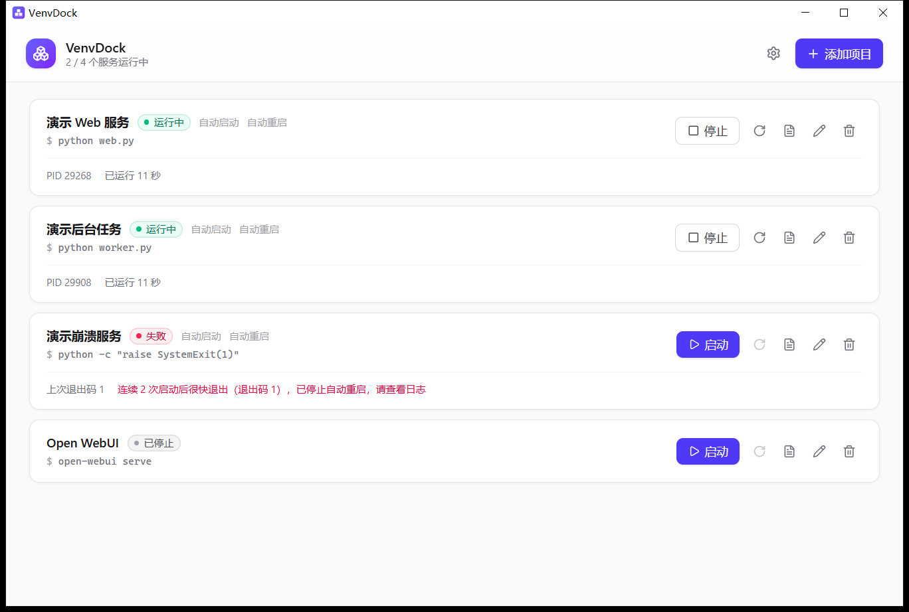
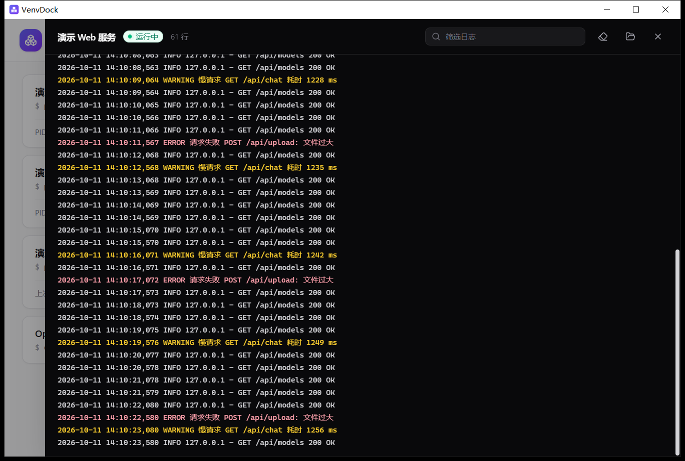

<div align="center">


# VenvDock

**Windows 本地服务托管面板**

在托盘常驻，托管 Python 虚拟环境中的服务（如 Open WebUI）或任意命令行程序：<br/>
一键启停、崩溃自动重启、实时日志、开机自启。


[下载安装包](../../releases/latest)

</div>

<p align="center">
  
  
</p>

## ✨ 功能

| | |
|---|---|
| 🚀 **启停与重启** | 停止时先发送 Ctrl+C 让服务优雅退出，超时再强制结束整个进程树 |
| 🧹 **不留孤儿进程** | 子进程全部放入 Job Object，VenvDock 退出或崩溃时一并回收 |
| 🔁 **崩溃自动重启** | 指数退避（默认 3 秒起、上限 60 秒），连续快速失败超过次数后放弃并提示 |
| 📜 **实时日志** | 界面内实时查看、筛选、按级别着色；按大小轮转写入文件；自动处理 GBK / UTF-8 混合输出 |
| 🐍 **venv 支持** | 指定虚拟环境即等同于先激活它；可设置工作目录、日志目录、环境变量 |
| 🖥️ **托盘常驻** | 开机自启（默认只在托盘）、单实例、关闭窗口即最小化到托盘 |

## 📦 安装

从 [Releases](../../releases/latest) 下载 `VenvDock_x.y.z_x64-setup.exe` 并运行，按当前用户安装，无需管理员权限。

> 依赖系统自带的 WebView2（Windows 10/11 均已预装）。

## 🧭 使用

1. 点击 **添加项目**，填写名称和启动命令，例如：

   | 字段 | 示例 |
   |---|---|
   | 启动命令 | `open-webui serve` |
   | 虚拟环境 | `F:\AI\OpenWebUI\venv` |
   | 环境变量 | `PORT=8080` |

2. 勾选 **自动启动** 后，VenvDock 启动时会自动拉起该项目；勾选 **自动重启** 后，意外退出会按退避策略重新启动。
3. 点击卡片上的日志图标查看实时输出。

命令通过 `cmd /c` 执行，支持 `&&`、管道和 `.bat`。

## 📁 文件位置

| 内容 | 路径 |
|---|---|
| 配置 | `%APPDATA%\com.venvdock.app\config.json` |
| 日志（默认） | `%APPDATA%\com.venvdock.app\logs\<项目名>.log` |

## 🛠️ 开发

需要 Rust、Node.js、pnpm 和 MSVC 构建工具。

```bash
pnpm install
pnpm tauri dev      # 开发运行（开发版不会写入开机自启注册表项）
pnpm tauri build    # 打包，输出到 src-tauri/target/release/bundle/nsis/
```

```text
src/                  前端（Vue 3 + Tailwind CSS 4）
src-tauri/src/
├─ config/            配置模型与原子存储
├─ runtime/
│  ├─ runner.rs       单个进程：启动、输出采集、优雅停止
│  ├─ supervisor.rs   状态机与退避重启
│  ├─ loghub.rs       实时日志推送
│  ├─ logs.rs         行切分、编码处理、日志轮转
│  └─ win.rs          Win32 封装（Job Object、Ctrl+C 等）
└─ commands.rs        前端调用的命令
```
